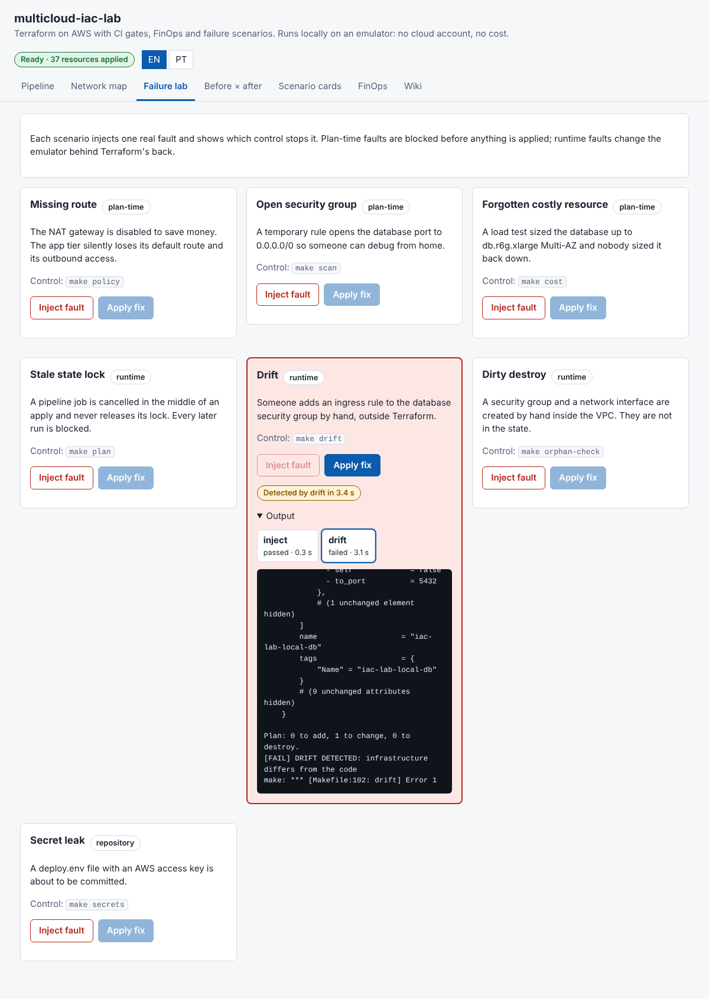

multicloud-iac-lab
==================

Terraform na AWS com os controles de um pipeline de produção: gates de segurança e
qualidade, orçamento de custo, detecção de drift e de órfãos, e sete cenários de falha
que provam que cada controle funciona. Roda inteiro em um emulador local: **sem conta de
nuvem, sem custo**.

`English <README.rst>`_

Início rápido
-------------

Só precisa de Docker (o ``make`` é opcional).

.. code-block:: bash

   make up      # http://localhost:8080
   make ci      # todos os gates do pipeline
   make test    # apply, injeta as sete falhas, destroy, orphan-check
   make down

Sem ``make``: ``docker compose up -d --build --wait``.

O que tem dentro
----------------

- **Módulos AWS**: VPC em três camadas, RDS PostgreSQL privado, alarmes e dashboard do CloudWatch.
- **Remote state**: S3 com versionamento e criptografia, lock no DynamoDB.
- **Pipeline**: fmt, validate, tflint, gitleaks, plan, Checkov, política de rotas e tags, orçamento de custo, aprovação manual, apply.
- **Laboratório de falhas**: rota ausente, security group aberto, recurso caro esquecido, lock de state preso, drift, destroy sujo, vazamento de segredo.
- **Também**: módulos Azure equivalentes, manifests Kubernetes de demonstração, runbook de migração.

Documentação
------------

A documentação detalhada é uma wiki dentro da tela web, em inglês e português.
Depois do ``make up``, abra a aba **Wiki** ou vá direto a um tópico:

========================  =============================================
Tópico                    Link
========================  =============================================
Visão geral               http://localhost:8080/#wiki/overview
Arquitetura               http://localhost:8080/#wiki/architecture
Módulos Terraform         http://localhost:8080/#wiki/modules
Remote state              http://localhost:8080/#wiki/state
Pipeline e gates          http://localhost:8080/#wiki/pipeline
Cenários de falha         http://localhost:8080/#wiki/scenarios
FinOps                    http://localhost:8080/#wiki/finops
Equivalente Azure         http://localhost:8080/#wiki/azure
Kubernetes                http://localhost:8080/#wiki/kubernetes
Runbook de migração       http://localhost:8080/#wiki/migration
Níveis de validação       http://localhost:8080/#wiki/validation
Decisões                  http://localhost:8080/#wiki/decisions
Lições aprendidas         http://localhost:8080/#wiki/lessons
Solução de problemas      http://localhost:8080/#wiki/troubleshooting
========================  =============================================

O que foi validado
------------------

O lado AWS é aplicado em um emulador (moto) e testado de ponta a ponta no CI. Os módulos
Azure e os manifests Kubernetes são verificados só com ``terraform validate`` e Checkov.
Nada foi executado em conta de nuvem real. O tópico *Níveis de validação* lista cada item.
