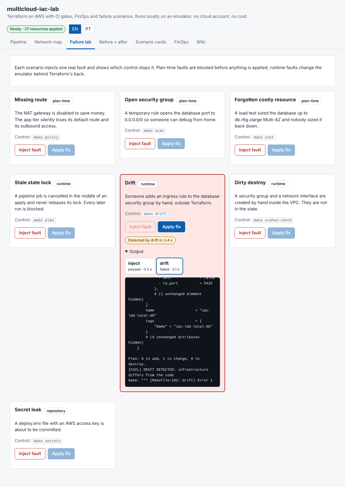

multicloud-iac-lab
==================

Terraform on AWS with the controls of a production pipeline: security and quality gates,
a cost budget, drift and orphan detection, and seven failure scenarios that prove each
control works. Runs entirely on a local emulator: **no cloud account, no cost**.

`Português <README.pt-BR.rst>`_

Quick start
-----------

Requires Docker only (``make`` is optional).

.. code-block:: bash

   make up      # http://localhost:8080
   make ci      # every pipeline gate
   make test    # apply, inject the seven failures, destroy, orphan-check
   make down

Without ``make``: ``docker compose up -d --build --wait``.

What is inside
--------------

- **AWS modules**: three-tier VPC, private PostgreSQL RDS, CloudWatch alarms and dashboard.
- **Remote state**: S3 with versioning and encryption, DynamoDB locking.
- **Pipeline**: fmt, validate, tflint, gitleaks, plan, Checkov, route and tag policy, cost budget, manual approval, apply.
- **Failure lab**: missing route, open security group, forgotten costly resource, stale state lock, drift, dirty destroy, secret leak.
- **Also**: equivalent Azure modules, Kubernetes demonstration manifests, a migration runbook.

Documentation
-------------

The detailed documentation is a wiki inside the web UI, in English and Portuguese.
After ``make up``, open the **Wiki** tab or go straight to a topic:

========================  =============================================
Topic                     Link
========================  =============================================
Overview                  http://localhost:8080/#wiki/overview
Architecture              http://localhost:8080/#wiki/architecture
Terraform modules         http://localhost:8080/#wiki/modules
Remote state              http://localhost:8080/#wiki/state
Pipeline and gates        http://localhost:8080/#wiki/pipeline
Failure scenarios         http://localhost:8080/#wiki/scenarios
FinOps                    http://localhost:8080/#wiki/finops
Azure equivalent          http://localhost:8080/#wiki/azure
Kubernetes                http://localhost:8080/#wiki/kubernetes
Migration runbook         http://localhost:8080/#wiki/migration
Validation levels         http://localhost:8080/#wiki/validation
Decisions                 http://localhost:8080/#wiki/decisions
Lessons learned           http://localhost:8080/#wiki/lessons
Troubleshooting           http://localhost:8080/#wiki/troubleshooting
========================  =============================================

What was validated
------------------

The AWS side is applied on an emulator (moto) and tested end to end in CI. The Azure
modules and the Kubernetes manifests are checked by ``terraform validate`` and Checkov
only. Nothing was executed in a real cloud account. The *Validation levels* topic lists
every item.
